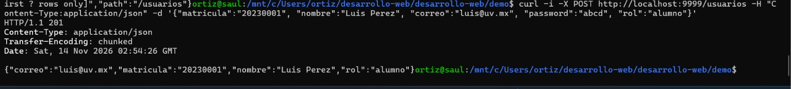
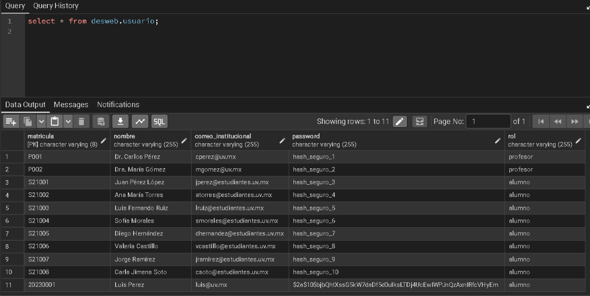
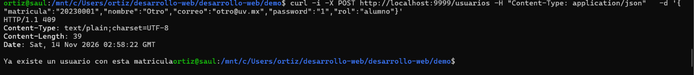
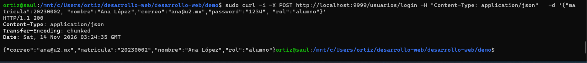
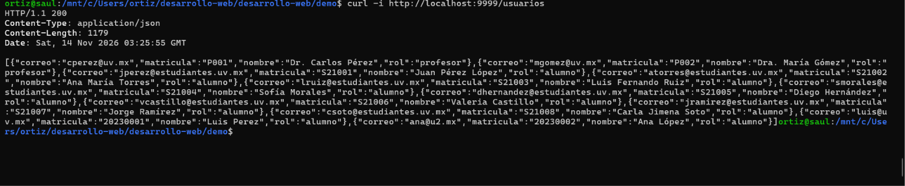

# Reporte de IA Desarrollo en el Proyecto

**Fecha:**  13/11/2026
**Número de reporte:** 1  

---

# 1. Breve descripción de uso

Describir la intención general del desarrollo.

Hacer pruebas curl sobre las entidades del proyecto para obtener y/o subir datos a la base de datos.

---

# 2. Evidencias de uso

| Evidencia | Formato | 
|------------|------------------------|
Herramienta | Claude
Modelo/temperatura | Somnet 5.5 / esfuerzo medio
Prompt original | [Prompt origina](#prompt-original)
Respuesta de IA | [Respuesta prompt](#Respuesta-prompt)
Código anterior | Commit (e6aebda)
Código posterior | Commit (c3b8b7c)
Diferencias entre versiones | git diff --numstat e6aebda c3b8b7c (copiar la salida) [Ver la salida del comando](#Salida-del-comando) 
Prueba de funcionamiento | CURL o captura imagen del resultado [imagenes de resultados](#Imagenes)
Código de uso | Generación / Modificación / Revisión / Pruebas
Reflexión del estudiante | Algunas peticiones son simples, simplemente colocando la ruta es sencillo listar todos los usuarios, otras requieren de un objeto que normalmente lleva el formato JSON. Hacer las pruebas desde consola muchas veces no es muy ilustrativo, tengo que revisar en la base de datos, en consola o en código para buscar el error y varias veces era solo un punto y coma que faltaba. 
Aunque es bueno tener una alternativa a una interfaz, la mayoría de los métodos requieron algún ajuste (en mi código) para poder funcionar


> El prompt y la respuesta pueden ser copiados como una subsección y enlazados

---

#### Prompt original
Ok, me podrías ayudar haciendo algunas pruebas curl en base a las clases que te estoy mostrando. Primero para Usuario con los métodos Get y POST nda más

#### Respuesta prompt
Estos ejemplos asumen que la aplicación corre en `http://localhost:8080`, el puerto por defecto de Spring Boot. Uso `-i` para que curl muestre también el código de estado (201, 409, 404...).

**Si estás en Windows**

En PowerShell, `curl` es un alias de otro comando y no acepta estas opciones. Escribe **`curl.exe`**. Además, las comillas del JSON dan problemas en PowerShell y CMD, así que lo más sencillo es guardar el JSON en un archivo y enviarlo con `-d "@archivo.json"`. En Linux, WSL o Git Bash puedes escribir el JSON directamente, como abajo.

**1. POST: crear usuarios**

```bash
# Crear un profesor -> 201 Created
curl -i -X POST http://localhost:8080/usuarios \
  -H "Content-Type: application/json" \
  -d '{"matricula":"20230001","nombre":"Ana López","correo":"ana@uv.mx","password":"1234","rol":"PROFESOR"}'

# Crear un alumno -> 201 Created
curl -i -X POST http://localhost:8080/usuarios \
  -H "Content-Type: application/json" \
  -d '{"matricula":"20240002","nombre":"Luis Pérez","correo":"luis@uv.mx","password":"abcd","rol":"ALUMNO"}'
```

Con el archivo `profesor.json`:

```bash
curl.exe -i -X POST http://localhost:8080/usuarios -H "Content-Type: application/json" -d "@profesor.json"
```

La respuesta correcta trae el usuario sin `password`:

```json
{"matricula":"20230001","nombre":"Ana López","correo":"ana@uv.mx","rol":"PROFESOR"}
```

**2. POST: casos de error**

```bash
# Matrícula repetida -> 409 Conflict
curl -i -X POST http://localhost:8080/usuarios -H "Content-Type: application/json" \
  -d '{"matricula":"20230001","nombre":"Otro","correo":"otro@uv.mx","password":"1","rol":"ALUMNO"}'

# Correo repetido -> 409 Conflict
curl -i -X POST http://localhost:8080/usuarios -H "Content-Type: application/json" \
  -d '{"matricula":"20250003","nombre":"Otro","correo":"ana@uv.mx","password":"1","rol":"ALUMNO"}'

# Matrícula con formato inválido (7 dígitos) -> 400 Bad Request
curl -i -X POST http://localhost:8080/usuarios -H "Content-Type: application/json" \
  -d '{"matricula":"1234567","nombre":"Test","correo":"t@uv.mx","password":"1","rol":"ALUMNO"}'

# Sin rol -> 400 Bad Request
curl -i -X POST http://localhost:8080/usuarios -H "Content-Type: application/json" \
  -d '{"matricula":"20250004","nombre":"Test","correo":"t2@uv.mx","password":"1"}'

# Rol que no existe -> 400 Bad Request
curl -i -X POST http://localhost:8080/usuarios -H "Content-Type: application/json" \
  -d '{"matricula":"20250005","nombre":"Test","correo":"t3@uv.mx","password":"1","rol":"MAESTRO"}'
```

**3. POST: login**

```bash
# Credenciales correctas -> 200 OK
curl -i -X POST http://localhost:8080/usuarios/login -H "Content-Type: application/json" \
  -d '{"correo":"ana@uv.mx","password":"1234"}'

# Contraseña incorrecta -> 401 Unauthorized
curl -i -X POST http://localhost:8080/usuarios/login -H "Content-Type: application/json" \
  -d '{"correo":"ana@uv.mx","password":"mala"}'
```

**4. GET: consultas**

```bash
# Todos los usuarios
curl -i http://localhost:8080/usuarios

# Uno por matrícula -> 200, o 404 si no existe
curl -i http://localhost:8080/usuarios/20230001
curl -i http://localhost:8080/usuarios/99999999

# Solo profesores / solo alumnos
curl -i http://localhost:8080/usuarios/profesores
curl -i http://localhost:8080/usuarios/alumnos

# Por rol (genérico)
curl -i http://localhost:8080/usuarios/rol/PROFESOR

# Por nombre (coincidencia parcial, sin distinguir mayúsculas)
curl -i "http://localhost:8080/usuarios/buscar?nombre=ana"

# Nombre con espacios: deja que curl codifique el valor
curl -i -G http://localhost:8080/usuarios/buscar --data-urlencode "nombre=Ana López"

# Por correo exacto -> 200, o 404 si no existe
curl -i "http://localhost:8080/usuarios/correo?valor=ana@uv.mx"
```

**Qué revisar**

- **Password:** en ninguna respuesta debe aparecer. Si lo ves, falta el `@JsonProperty(access = WRITE_ONLY)` en la entidad.
- **Base de datos:** el password guardado debe ser un hash de 60 caracteres que empieza con `$2a$10$`, nunca `1234`.
- **Lista vacía:** `GET /usuarios/alumnos` antes de crear alumnos devuelve `[]` con código 200.
- **Rol en minúsculas:** `"rol":"profesor"` da 400, a menos que agregues `spring.jackson.mapper.accept-case-insensitive-enums=true` en `application.properties`.
- **Orden de pruebas:** como las matrículas y los correos no se pueden repetir, si vuelves a correr el primer POST te devolverá 409. Para empezar de cero, borra los registros de la tabla.

Para ver solo el código de estado, sin el cuerpo, agrega `-s -o /dev/null -w "%{http_code}\n"` (en Windows, `-o NUL`).


#### Salida del comando
96      0       Evidencias y reportes/Reportes-IA/Montse/r-ia-doc-yy.md
36      0       Evidencias y reportes/Reportes-IA/Saul/r-ia-dev-1.md
17      9       Evidencias y reportes/Reportes/r-act-2.md
58      0       demo/src/main/java/com/example/demo/Clases/Alumno.java
94      0       demo/src/main/java/com/example/demo/Clases/Entrega.java
60      0       demo/src/main/java/com/example/demo/Clases/Equipo.java
2       0       demo/src/main/java/com/example/demo/Clases/Examen.java
83      0       demo/src/main/java/com/example/demo/Clases/Grupo.java
78      0       demo/src/main/java/com/example/demo/Clases/Mensaje.java
2       0       demo/src/main/java/com/example/demo/Clases/Reactivo.java
2       2       demo/src/main/java/com/example/demo/Clases/Rol.java
96      0       demo/src/main/java/com/example/demo/Clases/Tarea.java
7       1       demo/src/main/java/com/example/demo/Clases/Usuario.java
49      0       demo/src/main/java/com/example/demo/Controladores/AlumnoControlador.java
84      0       demo/src/main/java/com/example/demo/Controladores/EntregaControlador.java
84      0       demo/src/main/java/com/example/demo/Controladores/EquipoControlador.java
124     0       demo/src/main/java/com/example/demo/Controladores/GrupoControlador.java
98      0       demo/src/main/java/com/example/demo/Controladores/MensajeControlador.java
0       1       demo/src/main/java/com/example/demo/Controladores/ReactivoControlador.java
51      0       demo/src/main/java/com/example/demo/Controladores/TareaControlador.java
5       4       demo/src/main/java/com/example/demo/Controladores/UsuarioControlador.java
18      0       demo/src/main/java/com/example/demo/Rep_Interfaces/IAlumno.java
18      0       demo/src/main/java/com/example/demo/Rep_Interfaces/IEntrega.java
18      0       demo/src/main/java/com/example/demo/Rep_Interfaces/IEquipo.java
31      0       demo/src/main/java/com/example/demo/Rep_Interfaces/IGrupo.java
17      0       demo/src/main/java/com/example/demo/Rep_Interfaces/IMensaje.java
:
96      0       Evidencias y reportes/Reportes-IA/Montse/r-ia-doc-yy.md
36      0       Evidencias y reportes/Reportes-IA/Saul/r-ia-dev-1.md
17      9       Evidencias y reportes/Reportes/r-act-2.md
58      0       demo/src/main/java/com/example/demo/Clases/Alumno.java
94      0       demo/src/main/java/com/example/demo/Clases/Entrega.java
60      0       demo/src/main/java/com/example/demo/Clases/Equipo.java
2       0       demo/src/main/java/com/example/demo/Clases/Examen.java
83      0       demo/src/main/java/com/example/demo/Clases/Grupo.java
78      0       demo/src/main/java/com/example/demo/Clases/Mensaje.java
2       0       demo/src/main/java/com/example/demo/Clases/Reactivo.java
2       2       demo/src/main/java/com/example/demo/Clases/Rol.java
96      0       demo/src/main/java/com/example/demo/Clases/Tarea.java
7       1       demo/src/main/java/com/example/demo/Clases/Usuario.java
49      0       demo/src/main/java/com/example/demo/Controladores/AlumnoControlador.java
84      0       demo/src/main/java/com/example/demo/Controladores/EntregaControlador.java
84      0       demo/src/main/java/com/example/demo/Controladores/EquipoControlador.java
124     0       demo/src/main/java/com/example/demo/Controladores/GrupoControlador.java
98      0       demo/src/main/java/com/example/demo/Controladores/MensajeControlador.java
0       1       demo/src/main/java/com/example/demo/Controladores/ReactivoControlador.java
51      0       demo/src/main/java/com/example/demo/Controladores/TareaControlador.java
5       4       demo/src/main/java/com/example/demo/Controladores/UsuarioControlador.java
18      0       demo/src/main/java/com/example/demo/Rep_Interfaces/IAlumno.java
18      0       demo/src/main/java/com/example/demo/Rep_Interfaces/IEntrega.java
18      0       demo/src/main/java/com/example/demo/Rep_Interfaces/IEquipo.java
31      0       demo/src/main/java/com/example/demo/Rep_Interfaces/IGrupo.java
17      0       demo/src/main/java/com/example/demo/Rep_Interfaces/IMensaje.java
1       1       demo/src/main/java/com/example/demo/Rep_Interfaces/IReactivo.java
17      0       demo/src/main/java/com/example/demo/Rep_Interfaces/ITarea.java
4       0       demo/src/main/java/com/example/demo/Rep_Interfaces/IUsuario.java
1       1       demo/src/main/resources/application.properties
2       1       demo/src/test/java/com/example/demo/DemoApplicationTests.java
~
~
~
~
~
~
~
~
~
~
~
~
~
~
~
~
~
~
~
~
~
~
~
~
~
~
(END)
96      0       Evidencias y reportes/Reportes-IA/Montse/r-ia-doc-yy.md
36      0       Evidencias y reportes/Reportes-IA/Saul/r-ia-dev-1.md
17      9       Evidencias y reportes/Reportes/r-act-2.md
58      0       demo/src/main/java/com/example/demo/Clases/Alumno.java
94      0       demo/src/main/java/com/example/demo/Clases/Entrega.java
60      0       demo/src/main/java/com/example/demo/Clases/Equipo.java
2       0       demo/src/main/java/com/example/demo/Clases/Examen.java
83      0       demo/src/main/java/com/example/demo/Clases/Grupo.java
78      0       demo/src/main/java/com/example/demo/Clases/Mensaje.java
2       0       demo/src/main/java/com/example/demo/Clases/Reactivo.java
2       2       demo/src/main/java/com/example/demo/Clases/Rol.java
96      0       demo/src/main/java/com/example/demo/Clases/Tarea.java
7       1       demo/src/main/java/com/example/demo/Clases/Usuario.java
49      0       demo/src/main/java/com/example/demo/Controladores/AlumnoControlador.java
84      0       demo/src/main/java/com/example/demo/Controladores/EntregaControlador.java
84      0       demo/src/main/java/com/example/demo/Controladores/EquipoControlador.java
124     0       demo/src/main/java/com/example/demo/Controladores/GrupoControlador.java
98      0       demo/src/main/java/com/example/demo/Controladores/MensajeControlador.java
0       1       demo/src/main/java/com/example/demo/Controladores/ReactivoControlador.java
51      0       demo/src/main/java/com/example/demo/Controladores/TareaControlador.java
5       4       demo/src/main/java/com/example/demo/Controladores/UsuarioControlador.java
18      0       demo/src/main/java/com/example/demo/Rep_Interfaces/IAlumno.java
18      0       demo/src/main/java/com/example/demo/Rep_Interfaces/IEntrega.java
18      0       demo/src/main/java/com/example/demo/Rep_Interfaces/IEquipo.java
31      0       demo/src/main/java/com/example/demo/Rep_Interfaces/IGrupo.java
17      0       demo/src/main/java/com/example/demo/Rep_Interfaces/IMensaje.java
1       1       demo/src/main/java/com/example/demo/Rep_Interfaces/IReactivo.java
17      0       demo/src/main/java/com/example/demo/Rep_Interfaces/ITarea.java
4       0       demo/src/main/java/com/example/demo/Rep_Interfaces/IUsuario.java
1       1       demo/src/main/resources/application.properties
2       1       demo/src/test/java/com/example/demo/DemoApplicationTests.java
~
~
~
~
~
~
~
~
~
~
~
~
~
~
~
~
~
~
~
~
~
~
~
~
~
~
~
~
~
~
~
~
~
(END)
96      0       Evidencias y reportes/Reportes-IA/Montse/r-ia-doc-yy.md
36      0       Evidencias y reportes/Reportes-IA/Saul/r-ia-dev-1.md
17      9       Evidencias y reportes/Reportes/r-act-2.md
58      0       demo/src/main/java/com/example/demo/Clases/Alumno.java
94      0       demo/src/main/java/com/example/demo/Clases/Entrega.java
60      0       demo/src/main/java/com/example/demo/Clases/Equipo.java
2       0       demo/src/main/java/com/example/demo/Clases/Examen.java
83      0       demo/src/main/java/com/example/demo/Clases/Grupo.java
78      0       demo/src/main/java/com/example/demo/Clases/Mensaje.java
2       0       demo/src/main/java/com/example/demo/Clases/Reactivo.java
2       2       demo/src/main/java/com/example/demo/Clases/Rol.java
96      0       demo/src/main/java/com/example/demo/Clases/Tarea.java
7       1       demo/src/main/java/com/example/demo/Clases/Usuario.java
49      0       demo/src/main/java/com/example/demo/Controladores/AlumnoControlador.java
84      0       demo/src/main/java/com/example/demo/Controladores/EntregaControlador.java
84      0       demo/src/main/java/com/example/demo/Controladores/EquipoControlador.java
124     0       demo/src/main/java/com/example/demo/Controladores/GrupoControlador.java
98      0       demo/src/main/java/com/example/demo/Controladores/MensajeControlador.java
0       1       demo/src/main/java/com/example/demo/Controladores/ReactivoControlador.java
51      0       demo/src/main/java/com/example/demo/Controladores/TareaControlador.java
5       4       demo/src/main/java/com/example/demo/Controladores/UsuarioControlador.java
18      0       demo/src/main/java/com/example/demo/Rep_Interfaces/IAlumno.java
18      0       demo/src/main/java/com/example/demo/Rep_Interfaces/IEntrega.java
18      0       demo/src/main/java/com/example/demo/Rep_Interfaces/IEquipo.java
31      0       demo/src/main/java/com/example/demo/Rep_Interfaces/IGrupo.java
17      0       demo/src/main/java/com/example/demo/Rep_Interfaces/IMensaje.java
1       1       demo/src/main/java/com/example/demo/Rep_Interfaces/IReactivo.java
17      0       demo/src/main/java/com/example/demo/Rep_Interfaces/ITarea.java
4       0       demo/src/main/java/com/example/demo/Rep_Interfaces/IUsuario.java
1       1       demo/src/main/resources/application.properties
2       1       demo/src/test/java/com/example/demo/DemoApplicationTests.java
~
~
~
~
~
~
~
~
~
~
~
~
~
~
~
~
~
~
~
~
~
~
~
~
~
~
~
~
~
~
~
~
~
~
~
~
~
~
(END)
96      0       Evidencias y reportes/Reportes-IA/Montse/r-ia-doc-yy.md
36      0       Evidencias y reportes/Reportes-IA/Saul/r-ia-dev-1.md
17      9       Evidencias y reportes/Reportes/r-act-2.md
58      0       demo/src/main/java/com/example/demo/Clases/Alumno.java
94      0       demo/src/main/java/com/example/demo/Clases/Entrega.java
60      0       demo/src/main/java/com/example/demo/Clases/Equipo.java
2       0       demo/src/main/java/com/example/demo/Clases/Examen.java
83      0       demo/src/main/java/com/example/demo/Clases/Grupo.java
78      0       demo/src/main/java/com/example/demo/Clases/Mensaje.java
2       0       demo/src/main/java/com/example/demo/Clases/Reactivo.java
2       2       demo/src/main/java/com/example/demo/Clases/Rol.java
96      0       demo/src/main/java/com/example/demo/Clases/Tarea.java
7       1       demo/src/main/java/com/example/demo/Clases/Usuario.java
49      0       demo/src/main/java/com/example/demo/Controladores/AlumnoControlador.java
84      0       demo/src/main/java/com/example/demo/Controladores/EntregaControlador.java
84      0       demo/src/main/java/com/example/demo/Controladores/EquipoControlador.java
124     0       demo/src/main/java/com/example/demo/Controladores/GrupoControlador.java
98      0       demo/src/main/java/com/example/demo/Controladores/MensajeControlador.java
0       1       demo/src/main/java/com/example/demo/Controladores/ReactivoControlador.java
51      0       demo/src/main/java/com/example/demo/Controladores/TareaControlador.java
5       4       demo/src/main/java/com/example/demo/Controladores/UsuarioControlador.java
18      0       demo/src/main/java/com/example/demo/Rep_Interfaces/IAlumno.java
18      0       demo/src/main/java/com/example/demo/Rep_Interfaces/IEntrega.java
18      0       demo/src/main/java/com/example/demo/Rep_Interfaces/IEquipo.java
31      0       demo/src/main/java/com/example/demo/Rep_Interfaces/IGrupo.java
17      0       demo/src/main/java/com/example/demo/Rep_Interfaces/IMensaje.java
1       1       demo/src/main/java/com/example/demo/Rep_Interfaces/IReactivo.java
17      0       demo/src/main/java/com/example/demo/Rep_Interfaces/ITarea.java
4       0       demo/src/main/java/com/example/demo/Rep_Interfaces/IUsuario.java
1       1       demo/src/main/resources/application.properties
2       1       demo/src/test/java/com/example/demo/DemoApplicationTests.java
~
~
~
~
~
~
~
~
~
~
~
~
~
~
~
~
~
~
~
~
~
~
~
~
~
~
~
~
~
~
~
~
~
(END)

#### Imagenes






## Observaciones adicionales

Agregar cualquier comentario explicativo relevante.
Hubo varios commits después del ultimo mio, no sé si eso afecta en la salida del comando de git