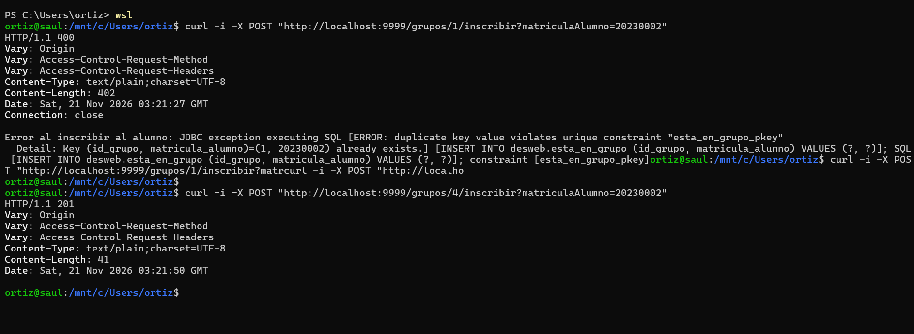

# Reporte de IA Desarrollo en el Proyecto

**Fecha:**  20/11/2026
**Número de reporte:** 3  

---

# 1. Breve descripción de uso

Describir la intención general del desarrollo.
Dudas sobre errores en uno de los métodos fetch del proyecto

---

# 2. Evidencias de uso

| Evidencia | Formato | 
|------------|------------------------|
Herramienta | Claude
Modelo/temperatura | Sonnet 5.5
Prompt original | Ok, un detalle del que me dí cuenta es que en la opción de crear un grupo me aparece un error que hace que no se listen los usuarios al crear un proyecto
Respuesta de IA | [Respuesta](#Respuesta-de-IA)
Código anterior | Commit (48d2b5d)
Código posterior | Commit (0897eef)
Diferencias entre versiones | [Salida del comando](#Salida-comando) git diff --numstat 48d2b5d 0897eez 
Prueba de funcionamiento | CURL o captura imagen del resultado 
Código de uso | Generación / Modificación 
Reflexión del estudiante | Pude notar leves modificaciones en mis métodos con parte de código enfocado a una mayor optimización, prevenir errores o cosas por el estilo, pero, al final el comportamiento es similar


> El prompt y la respuesta pueden ser copiados como una subsección y enlazados

---

## Observaciones adicionales

Agregar cualquier comentario explicativo relevante.

#### Respuesta de IA
El error de la consola es de CORS, no de tu JavaScript: *"Access to fetch at 'http://localhost:9999/usuarios' ... has been blocked by CORS policy: No 'Access-Control-Allow-Origin' header is present"*. El servidor sí recibe la petición, pero su respuesta no trae el permiso para que el navegador se la entregue a tu página. Los grupos sí se cargan porque `GrupoControlador` tiene `@CrossOrigin`, y `UsuarioControlador` no.

**Solución rápida**

Agrega la anotación a `UsuarioControlador`:

```java
import org.springframework.web.bind.annotation.CrossOrigin;

@CrossOrigin(origins = "*")
@RestController
@RequestMapping("/usuarios")
public class UsuarioControlador { ... }
```

Después **reinicia el backend**. Spring Boot no recarga los cambios de Java por sí solo, así que si no lo reinicias el error seguirá igual.

**Solución más cómoda: un solo permiso para todo el backend**

Vas a necesitar lo mismo en `ExamenControlador` y en los que vengan. En lugar de repetir la anotación, crea una clase de configuración en el paquete `com.example.demo`:

```java
package com.example.demo;

import org.springframework.context.annotation.Configuration;
import org.springframework.web.servlet.config.annotation.CorsRegistry;
import org.springframework.web.servlet.config.annotation.WebMvcConfigurer;

@Configuration
public class CorsConfig implements WebMvcConfigurer {

    @Override
    public void addCorsMappings(CorsRegistry registry) {
        registry.addMapping("/**")
                .allowedOrigins("*")
                .allowedMethods("GET", "POST", "PUT", "DELETE", "OPTIONS");
    }
}
```

Con esa clase puedes quitar los `@CrossOrigin` de cada controlador, aunque dejarlos no causa problemas.

**Cómo comprobar que quedó**

Con el backend reiniciado, en la terminal de WSL:

```bash
curl -i -H "Origin: http://127.0.0.1:3000" http://localhost:9999/usuarios
```

En las cabeceras de la respuesta debe aparecer `Access-Control-Allow-Origin: *`. Si aparece, recarga la página (`Ctrl + F5`) y abre el modal: la lista de usuarios ya debe llenarse.

**Un detalle de tu captura**

El mensaje dice `from origin 'null'`, lo que indica que esa página no la abriste con Live Server (que muestra `http://127.0.0.1:3000`), sino directamente como archivo. Con `allowedOrigins("*")` funciona igual, pero conviene abrirla siempre con Live Server para que las pruebas sean uniformes.


#### Salida comando
$ git diff --numstat a629a51 f2a5bb1
2       1       demo/src/main/java/com/example/demo/Clases/Entrega.java
3       1       demo/src/main/java/com/example/demo/Clases/Equipo.java
2       0       demo/src/main/java/com/example/demo/Clases/Examen.java
1       1       demo/src/main/java/com/example/demo/Clases/Grupo.java
1       1       demo/src/main/java/com/example/demo/Clases/Mensaje.java
1       1       demo/src/main/java/com/example/demo/Clases/Reactivo.java
1       1       demo/src/main/java/com/example/demo/Clases/Tarea.java
11      0       demo/src/main/java/com/example/demo/Controladores/GrupoControlador.java
2       0       demo/src/main/java/com/example/demo/Rep_Interfaces/IGrupo.java
1       0       demo/src/main/resources/application.properties
0       1       frontend/html/PaginaProfesor.html
5       0       frontend/javascript/PaginaProfesor.js
