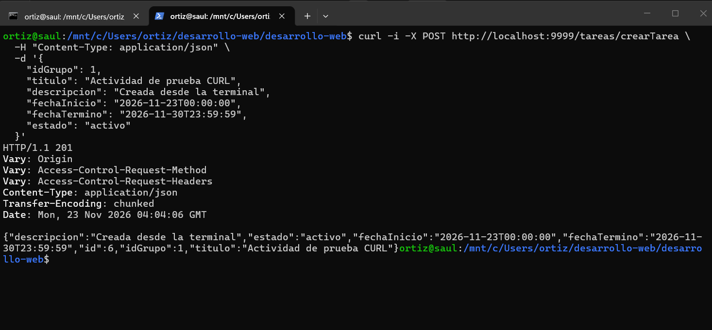
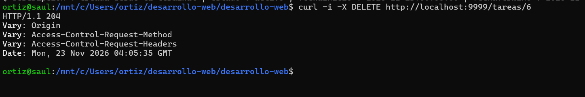

# Reporte de IA Desarrollo en el Proyecto

**Fecha:**  20/11/2026
**Número de reporte:** 4

---

# 1. Breve descripción de uso

Describir la intención general del desarrollo.
Dudas sobre errores en uno de los métodos fetch del proyecto y su implementación con el diseño y apariencia planteados en el prototipo

---

# 2. Evidencias de uso

| Evidencia | Formato | 
|------------|------------------------|
Herramienta | Claude
Modelo/temperatura | Sonnet 5.5
Prompt original | Bueno, antes de nada me gustaría compartirte el diseño que tenía planteado para este modal de crear actividad. Dejo fuera a calificación 
pues retiraré el atributo de la tabla en postgres. Como ves, hay una sección para que la actividad sea individual o en equipo, genera solo la estructura y dejemos la funcionalidad para después
Respuesta de IA | [Respuesta](#Respuesta-de-IA)
Código anterior | Commit (c5d8be2)
Código posterior | Commit (9ef0f7b)
Diferencias entre versiones | [Salida del comando](#Salida-comando) git diff --numstat 48d2b5d 0897eez 
Prueba de funcionamiento | CURL o captura imagen del resultado 

Código de uso | Generación / Modificación 
Reflexión del estudiante | Me ayudó bastante con el diseño CSS que es al final el archivo con más lineas y luego más dificil de depurar solo por el tamaño
Me sugirió opciones que no había considerado y que acabé implementando aunque no estuvieran en mi diseño, por ser más practicas o por temas de tiempo

> El prompt y la respuesta pueden ser copiados como una subsección y enlazados

---

## Observaciones adicionales

La IA ADjuntó archivos sobre su propuesta al diseño que le propuse y me ayudó en la construcción y revisión de este

#### Respuesta de IACon el diseño ya tengo claro cómo debe verse. Rehago los tres fragmentos: el modal tiene ahora cabecera de color, selector de hora, tipo de actividad y la sección de equipo, esta última solo como estructura.

Actualicé los tres fragmentos (`modal-crear-actividad.html`, `crear-actividad.css` y `crear-actividad.js`) siguiendo tu maqueta. Se pegan igual que antes y reemplazan las versiones anteriores.

**Qué refleja del diseño**
- **Cabecera**: una banda de color con el título y la "x" para cerrar.
- **Fecha y hora**: la maqueta muestra un solo par fecha/hora, pero la tabla exige inicio y término, así que puse dos filas, Inicio y Cierre, cada una con su fecha y un selector de hora. Las horas van cada 30 minutos más 23:59. Por defecto inicia a las 00:00 y cierra a las 23:59, igual que tus registros actuales.
- **Tipo de actividad**: un interruptor Individual/Equipo con marca de selección. Individual viene marcado por defecto, como en tu segundo diseño.
- **Sección de equipo**: "Modo de asignación", la lista "Alumnos y equipos" con dos filas de ejemplo y "Miembros máximos por equipo". Solo aparece al elegir Equipo, y la lista solo con asignación manual. Eso se controla con CSS (`:has()`), sin JS, así que funciona en navegadores recientes (Chrome 105+, Firefox 121+).
- **Estilos**: el CSS ahora es autónomo, todo limitado a `#modal-crear-tarea`, y ya no depende de las clases del modal de grupo ni de tu CSS. Los colores los tomé de la maqueta; cámbialos por tus variables si ya las tienes.

**Qué queda pendiente**
- El JS solo envía título, descripción, fechas y `estado: "activo"`. El tipo, el modo, los miembros máximos y los **Puntos** se muestran pero todavía no se envían, porque no existen en el backend. Está marcado con un comentario `PENDIENTE` en el código.
- Duda sobre **Puntos**: dices que sacarás `calificacion` de la tabla pero conservas Puntos en el diseño. ¿Puntos va a ser la nueva columna que lo reemplaza? Si es así, ya puedo conectarlo cuando la crees.

**Al quitar `calificacion` de Postgres**
- Borra el campo, su getter/setter y las anotaciones `@DecimalMin`, `@DecimalMax`, `@Digits` en `Tarea.java`. Los imports de `BigDecimal` y de esas anotaciones también se pueden quitar si ya nadie los usa.
- Elimina la línea `tareaExistente.setCalificacion(tareaActualizada.getCalificacion());` del `PUT` en `TareaControlador`; si no, el proyecto deja de compilar.
- Con esto, el pendiente anterior de cambiar `@DecimalMax` a 10 deja de aplicar.

Cuando quieras avanzar con la parte de equipos, el siguiente paso sería definir qué guarda el backend (tablas o columnas para el tipo, los equipos y sus integrantes) y luego llenar la lista con los alumnos del grupo usando `/usuarios/grupo/{id}/alumnos`, que ya usas en Entregas.
(Aquí me dio un archivo JS, HTML y un CSS)

#### Salida comando
$ git diff --numstat 9ef0f7b c5d8be2
6       6       demo/src/main/java/com/example/demo/Clases/Examen.java
18      24      demo/src/main/java/com/example/demo/Controladores/EntregaControlador.java
0       77      frontend/css/PaginaProfesor.css
8       92      frontend/javascript/PaginaProfesor.js

