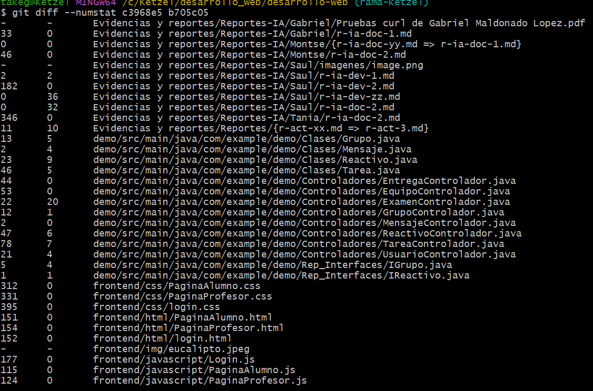
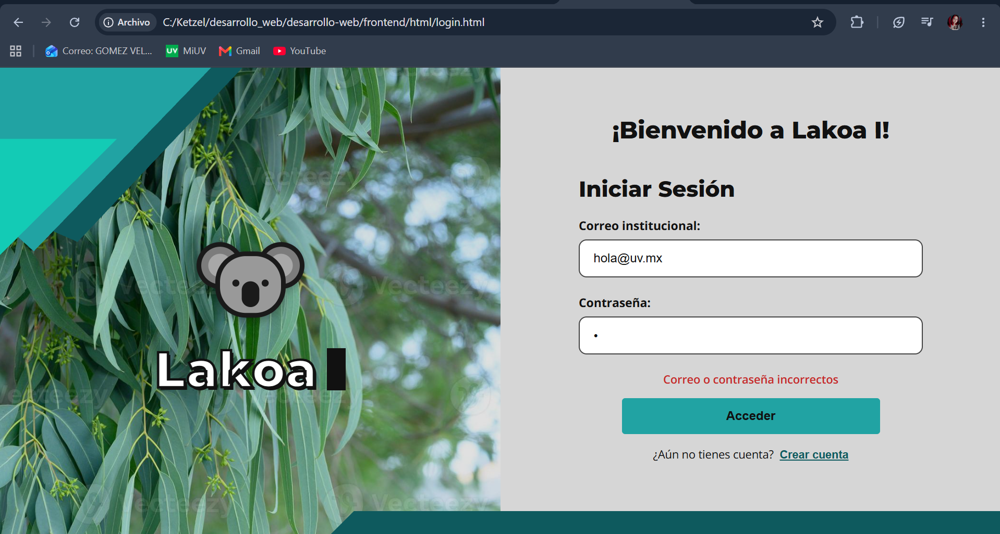
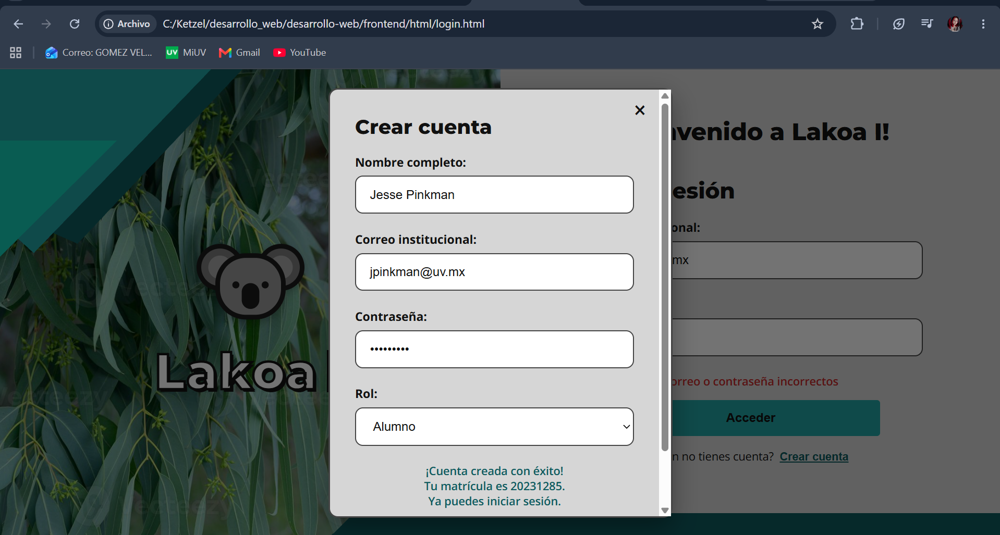

# Reporte de IA Desarrollo en el Proyecto

**Fecha:** 20 de noviembre de 2026  
**Número de reporte:** 3

---

# 1. Breve descripción de uso

Apoyo en el diseño e implementación de la vista de inicio de sesión (`login.html`, `login.css` y `login.js`) para el sistema **Lakoa I**, incluyendo el modal de registro de usuarios, la integración con el servicio de autenticación en Java (`POST /usuarios/login` y `POST /usuarios`), la generación automática de matrículas de ocho dígitos y la resolución de incidencias de rutas relativas, alcance de variables y validación de campos durante las pruebas iniciales.

---

# 2. Evidencias de uso

| Evidencia | Formato | 
|------------|------------------------|
Herramienta | Asistente de IA Generativa (Gemini) |
Modelo/temperatura | No especificado / predeterminado de la sesión |
Prompt original | Solicitud de apoyo para construir la página de inicio de sesión a partir de un prototipo en HTML, CSS y JavaScript conectada a un backend en Java, seguida de ajustes visuales, modal de registro, asignación automática de matrícula y depuración de errores en consola. |
Respuesta de IA | Propuestas de estructura HTML, estilos CSS (incluyendo recortes geométricos y paleta cromática), lógica de peticiones HTTP con `fetch` en JavaScript, adecuaciones en `UsuarioControlador` para generar matrículas únicas y diagnósticos de errores en navegador. |
Código anterior | Commit https://github.com/Saul848/desarrollo-web/commit/c3968e5ea76b37038de223f64bc898f08df8d68a |
Código posterior | Commit https://github.com/Saul848/desarrollo-web/commit/b705c051ed7daf0bbfb8e4b2acad325ad038c051 |
Diferencias entre versiones |  |
Prueba de funcionamiento |  |
Código de uso | Generación / Modificación / Depuración / Explicación / Diseño |
Reflexión del estudiante | Se logró crear la página de inicio de sesión y de registro exitosamente, se corrigieron algunos métodos del controlador de usuario para lograr crear una matrícula aleatoriamente y evitar que el usuario la ingrese manualmente cuando haga su registro, conservando así la consistencia en las matrículas. |

> El prompt y la respuesta pueden ser copiados como una subsección y enlazados

---

## Observaciones adicionales

* Al abrir archivos HTML directamente desde el sistema de archivos (`file://`) hacia un servidor backend en `localhost`, es necesario considerar la configuración de CORS en el backend y el uso de rutas relativas (`../`) hacia las carpetas `css` y `javascript`.
